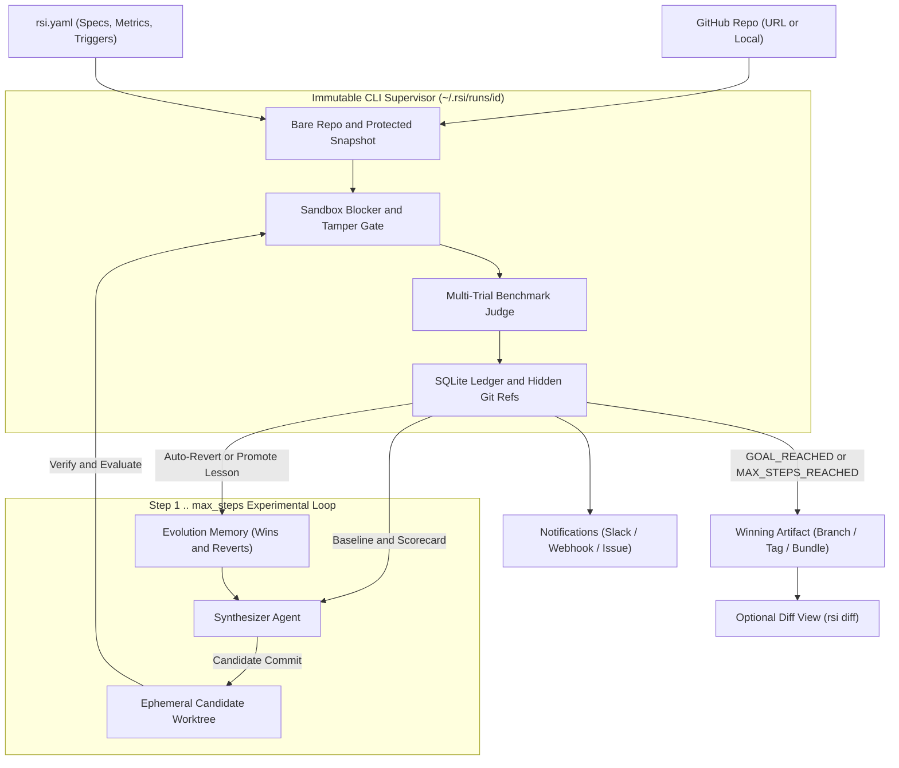
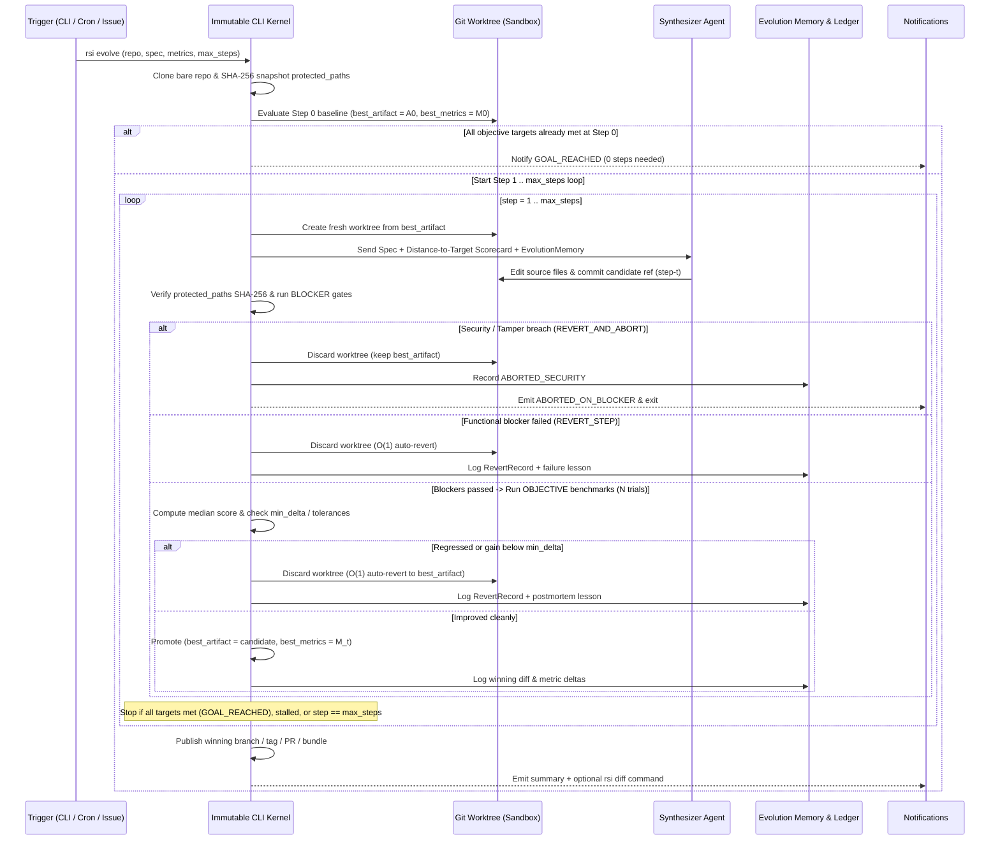
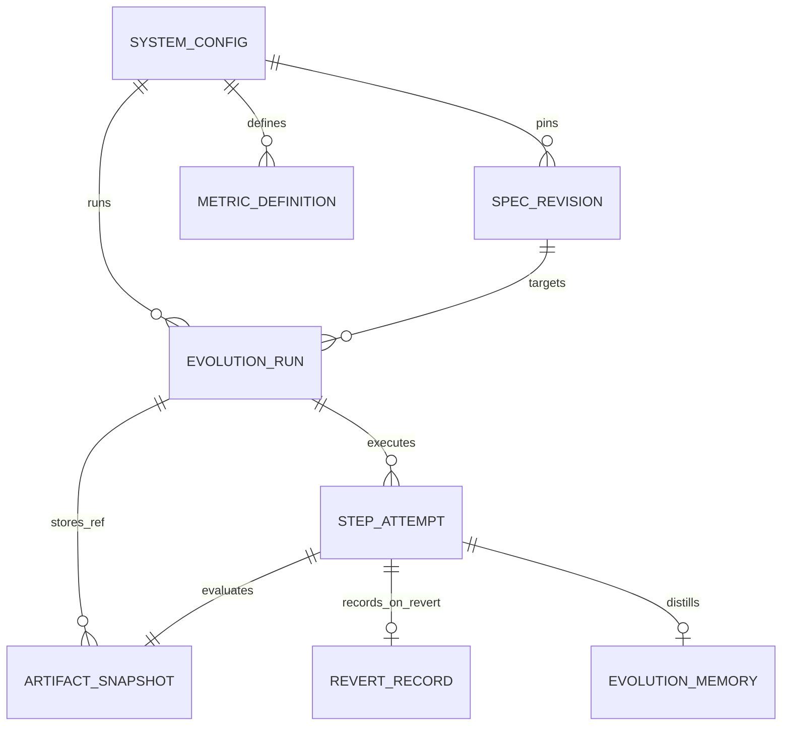

# RSI Framework (v1 OSS CLI): Spec & Metric-Driven Repo Evolution

This document defines the v1 architecture, declarative manifest (`rsi.yaml`), data model, CLI workflow, and safety boundaries for an **open-source Recursive Self-Improvement (RSI) CLI**.

In v1, a user points `rsi evolve` at a **GitHub repository**, a **behavioral spec**, and **objective + blocker metrics**. The CLI autonomously iterates in an experimental hill-climbing loop—synthesizing candidate code changes, gating against security and correctness blockers, benchmarking objectives across isolated trials, and **auto-reverting** failed or regressed steps—until **all target metrics are reached (`GOAL_REACHED`)** or **`max_steps` is reached (`MAX_STEPS_REACHED`)**.

Code changes are stored as internal Git artifact refs (`refs/rsi/<run_id>/*`) rather than noisy human PRs at every step. Humans receive an async summary on completion and can inspect the clean net change via an optional `rsi diff` view.

> [!IMPORTANT]
> **Local Anti-Reward-Hacking (Out-of-Tree Immutable Kernel):** The Rust CLI supervisor executes outside the mutable candidate directory (under `~/.rsi/runs/<run_id>/`). Before Step 1, it snapshots `rsi.yaml`, the spec file, and all `protected_paths` (acceptance test suites, security scanners, and benchmark harnesses) with SHA-256 checksums, locks them read-only (`0o444`) inside the local Git worktree during synthesis, and verifies exact file/hash integrity before running evaluations. The synthesizer agent can never "reach a target metric" by weakening tests or rewriting the benchmark.

---

## 1. OSS CLI Architecture & Iterative Evolution Loop

### Component Topology



### Step-by-Step Experimental & Auto-Revert Lifecycle



### Why Multi-Trial Paired Scoring Matters

Performance, latency, and throughput metrics fluctuate across runs. Evaluating a single noisy run causes false promotions (hill-climbing on noise) or unnecessary reverts. To prevent churn:
- **Command Deduplication:** Objective metrics sharing the same `command` (e.g., a benchmark binary emitting both `ops_per_sec` and `p99_ms`) execute once per trial and extract multiple metrics via JSONPath or regex.
- **Median-of-N Trials & `min_delta`:** Each candidate runs `trials` times (default `3–5`) in an isolated local Git worktree and must beat the current `best_artifact` median by at least `min_delta` while staying within `max_regression_tolerance` on secondary objectives.
- **Paired Re-Verification on Promotion:** Before sealing a promotion, the kernel optionally re-runs the baseline and candidate side-by-side (`A/B` in the same session) to eliminate thermal or background load drift.

---

## 2. Declarative Configuration Schema (`rsi.yaml`)

Users place an `rsi.yaml` file alongside the repo (or supply it externally via `--config` so the repo itself stays untouched until evolution succeeds):

```yaml
version: 1
name: dedupe-ranker-optimizer
language: python                      # auto | python | typescript

repo:
  url: https://github.com/acme/dedupe-ranker
  ref: main
  publish_on_complete: branch         # bundle_only | branch | tag

spec:
  file: ./specs/behavior.md
  invariants:
    - "Preserve stable input tie-breaking order for equal scores"
    - "Never mutate caller-owned input objects"
  protected_paths:
    - "tests/acceptance/**"
    - "benchmarks/**"
    - "rsi.yaml"

metrics:
  blockers:
    - id: acceptance_tests
      command: "python3 -m unittest discover -s tests -p 'test_*.py'"
      expect_exit_code: 0
      timeout_sec: 120
      on_breach: REVERT_STEP

    - id: hard_security_scan
      command: "python3 scripts/security_check.py"
      expect_exit_code: 0
      timeout_sec: 60
      on_breach: REVERT_AND_ABORT     # Immediately halts run and leaves baseline intact

  objectives:
    - id: throughput_ops_sec
      command: "python3 benchmarks/bench.py --json"
      extract_json_path: "$.ops_per_sec"
      direction: MAXIMIZE
      target: 150000                  # Stops with GOAL_REACHED once all targets hit
      min_delta: 2500                 # Minimum improvement over best_artifact to promote
      weight: 0.7
      trials: 3

    - id: p95_latency_ms
      command: "python3 benchmarks/bench.py --json"
      extract_json_path: "$.p95_ms"
      direction: MINIMIZE
      target: 1.5
      min_delta: 0.05
      max_regression_tolerance: 0.2   # Allow slight regression only if weighted score improves
      weight: 0.3
      trials: 3

evolution:
  max_steps: 20
  max_consecutive_reverts: 5          # Early stop as STALLED to protect LLM budget
  max_budget_usd: 15.0

agent:
  # Supports customer coding-agent subscriptions AND BYO API keys:
  # auto | claude_cli | codex_cli | gemini_cli | anthropic_api | gemini_api | openai_api | command
  driver: auto
  max_turns: 10

triggers:
  - kind: cron
    schedule: "0 2 * * 1"             # Weekly Monday 2am evolution sweep
  - kind: github_issue
    label: "rsi:feature-request"
    mode: append_scenario

notifications:
  events: [GOAL_REACHED, MAX_STEPS_REACHED, ABORTED_ON_BLOCKER, STALLED]
  channels:
    - type: slack_webhook
      url: "${RSI_SLACK_WEBHOOK}"
```

---

## 3. Data Model (Local SQLite Ledger + Git Artifact Refs)

In v1, the state store is a self-contained SQLite ledger (`~/.rsi/ledger.db`) paired with hidden Git refs (`refs/rsi/<run_id>/step-<n>`) inside a bare clone, requiring zero external databases.

### Entity Relationship Diagram



### TypeScript Schema

```typescript
export interface RepoConfig {
  url: string;                        // GitHub HTTPS/SSH URL or local path
  ref: string;                        // Base branch, tag, or commit SHA
  publish_on_complete: "branch" | "tag" | "pull_request" | "bundle_only";
}

export interface SpecRevision {
  id: string;                         // e.g. "spec_9d2f"
  intent_markdown: string;
  invariants: string[];
  protected_paths: string[];
  protected_paths_sha256: Record<string, string>; // Computed at Step 0; verified every step
  feature_amendments?: string[];      // Appended via --feature or issue triggers
}

export interface ExtractorSpec {
  type: "JSON_PATH" | "REGEX" | "EXIT_CODE";
  expression: string;
}

export interface ObjectiveSpec {
  direction: "MAXIMIZE" | "MINIMIZE";
  target?: number;                    // Stop early with GOAL_REACHED when met
  min_delta: number;                  // Minimum gain required to promote
  weight: number;
  trials: number;                     // Number of sandbox runs averaged/medianed
  max_regression_tolerance?: number;
  extract: ExtractorSpec;
}

export interface BlockerSpec {
  expect_exit_code?: number;
  operator?: "EQ" | "LT" | "LTE" | "GT" | "GTE";
  threshold?: number;
  on_breach: "REVERT_STEP" | "REVERT_AND_ABORT";
}

export interface MetricDefinition {
  id: string;
  role: "BLOCKER" | "OBJECTIVE";
  command: string;
  timeout_sec: number;
  blocker?: BlockerSpec;
  objective?: ObjectiveSpec;
}

export interface StoppingPolicy {
  max_steps: number;
  stop_when_all_targets_met: boolean;
  max_consecutive_reverts: number;
  max_budget_usd: number;
}

export interface EvolutionRun {
  id: string;                         // e.g. "run_20261122_01"
  repo_url: string;
  base_sha: string;
  spec_revision_id: string;
  best_artifact_id: string;           // Initialized to Step 0 baseline artifact
  current_step: number;
  stopping_policy: StoppingPolicy;
  status:
    | "RUNNING"
    | "GOAL_REACHED"
    | "MAX_STEPS_REACHED"
    | "ABORTED_ON_BLOCKER"
    | "STALLED";
  baseline_scorecard: Record<string, number>;
  best_scorecard: Record<string, number>;
  total_cost_usd: number;
  started_at: string;
  completed_at?: string;
}

export interface RevertRecord {
  reverted_at: string;
  reason: "TAMPER_DETECTED" | "BLOCKER_BREACH" | "OBJECTIVE_REGRESSION" | "INSUFFICIENT_DELTA";
  failed_metric_id?: string;
  observed_value?: number;
  expected_or_baseline?: number;
}

export interface StepAttempt {
  id: string;
  run_id: string;
  step_number: number;
  parent_artifact_id: string;         // Current best_artifact_id entering this step
  candidate_artifact_id: string;
  hypothesis: string;
  outcome: "PROMOTED" | "REVERTED_BLOCKER" | "REVERTED_OBJECTIVE" | "ABORTED_SECURITY";
  blocker_results: { metric_id: string; passed: boolean; duration_ms: number }[];
  objective_measurements: { metric_id: string; trial_values: number[]; median: number }[];
  revert_record?: RevertRecord;
  cost_usd: number;
}

export interface ArtifactSnapshot {
  id: string;                         // e.g. "art_step07"
  run_id: string;
  git_ref: string;                    // e.g. "refs/rsi/run_20261122_01/step-7"
  commit_sha: string;
  tree_sha256: string;
  parent_artifact_id: string | null;
  diff_stats: { files_changed: number; insertions: number; deletions: number };
}

export interface EvolutionMemory {
  id: string;
  run_id: string;
  step_number: number;
  outcome: "PROMOTED" | "REVERTED_BLOCKER" | "REVERTED_OBJECTIVE";
  hypothesis: string;
  diff_summary: string;
  metric_deltas: Record<string, number>;
  lesson: string;                     // Injected into subsequent synthesis prompts
}
```

---

## 4. CLI Command Surface, Triggers & Optional Diff View

### Command Reference

| Command | Purpose | Key Flags |
| :--- | :--- | :--- |
| `rsi init` | Scaffolds `rsi.yaml`, spec template, and optional GitHub Action workflow | `--lang`, `--dir`, `--ci` |
| `rsi bootstrap-eval` | Inspects a bare legacy repo out-of-tree and builds a Golden-Master Eval Pack | `--repo`, `--spec`, `--target`, `--wrapper`, `--target-ratio` |
| `rsi evolve` | Clones repo, runs Step `0..max_steps` loop (auto-bootstraps if no `rsi.yaml`) | `--repo`, `--config`, `--spec`, `--publish pull-request\|zero-pr\|bundle-only`, `--auto-merge` |
| `rsi publish [<run_id>]` | Publishes an already-completed run to GitHub as a PR or Zero-PR trunk push | `--mode pull-request\|zero-pr\|branch\|tag`, `--auto-merge`, `--base-branch` |
| `rsi status [<run_id>]` | Shows current step, `baseline -> best -> target` scorecard, and revert count | `--json` |
| `rsi diff [<run_id>]` | **Optional Diff View:** net diff from `base_sha` to `best_sha` (hides reverted dead-ends) | `--step <n>`, `--view unified\|semantic` |
| `rsi log <run_id>` | Prints chronological step ledger (promoted wins, auto-reverts, and lessons) | `--only-promoted` |
| `rsi watch` | Runs local cron scheduler and HTTP webhook listener for trigger events | `--config`, `--once`, `--port` |

### GitHub Delivery Modes (PR-Based vs. Zero-PR)

At CLI invocation time (via `rsi evolve --publish ...` or post-hoc via `rsi publish --mode ...`), teams can toggle how promoted artifacts land on GitHub:
- **PR-Based (`pull-request` / `pr`, optional `--auto-merge`):** Squashes promoted steps onto `rsi/<run_id>`, pushes to GitHub `origin`, and opens a Pull Request populated with the Baseline -> Evolved metric scorecard and promoted hypotheses (enabling `--auto --squash` merge when `--auto-merge` is set).
- **Zero-PR (`zero-pr` / `direct`):** Squashes promoted steps into a single commit and fast-forward pushes straight to trunk (`main`) on GitHub `origin`, emitting a `/compare/<base>...<head>` URL for optional diff auditing.

### Zero-Infra Cron & Feature-Request Triggers (GitHub Actions)

Teams can enable scheduled optimization and issue-driven feature evolution with zero hosted infrastructure using a 20-line GitHub Action (`.github/workflows/rsi.yml`):

```yaml
name: RSI Autonomous Evolution
on:
  schedule:
    - cron: "0 2 * * 1"                     # Scheduled optimization sweep
  issues:
    types: [labeled]                        # Event trigger: label = rsi:feature-request

jobs:
  evolve:
    if: github.event_name == 'schedule' || contains(github.event.issue.labels.*.name, 'rsi:feature-request')
    runs-on: ubuntu-latest
    steps:
      - uses: actions/checkout@v4
      - run: |
          npx @rsi/cli evolve \
            --config rsi.yaml \
            --feature "${{ github.event.issue.body }}" \
            --publish pull_request
        env:
          LLM_API_KEY: ${{ secrets.LLM_API_KEY }}
          GITHUB_TOKEN: ${{ secrets.GITHUB_TOKEN }}
```

When `--feature` is passed, Phase 0a compiles the feature request into a candidate `SpecRevision` amendment (and optionally an acceptance test stored in the out-of-tree snapshot) **before** locking `protected_paths_sha256`—ensuring the synthesizer still cannot tamper with existing or newly added checks.

### Notification Summary Payload

Upon reaching `GOAL_REACHED`, `MAX_STEPS_REACHED`, `ABORTED_ON_BLOCKER`, or `STALLED`, `rsi` emits an async notification summarizing the net outcome without exposing intermediate failed code:

```json
{
  "event_type": "GOAL_REACHED",
  "run_id": "run_20261122_01",
  "repo": "https://github.com/acme/kv-engine",
  "steps_executed": 11,
  "max_steps": 20,
  "steps_promoted": 4,
  "steps_auto_reverted": 7,
  "metrics": {
    "throughput_ops_sec": { "baseline": 82400, "final": 154200, "target": 150000 },
    "p99_latency_ms": { "baseline": 2.9, "final": 1.38, "target": 1.5 }
  },
  "published_branch": "rsi/run_20261122_01",
  "inspect_diff_cmd": "rsi diff run_20261122_01 --view semantic"
}
```

---

## 5. v2 Roadmap: Extending to Hosted Continuous Canary

> [!TIP]
> **Seamless Upgrade Path from Local CLI to Hosted Production:** Every core primitive in v1 (`SpecRevision`, `MetricDefinition`, `ArtifactSnapshot`, `RevertRecord`, `EvolutionMemory`) maps 1-to-1 to v2's hosted continuous canary platform—only the **experiment evaluator** and **rollback mechanism** upgrade from offline benchmarks to live traffic.

- **Evaluation Engine:** v1 `trials: N` offline benchmark median -> v2 `mSPRT` sequential statistical judge over live shadow & canary traffic.
- **Auto-Revert Mechanism:** v1 `O(1)` Git worktree discard (`refs/rsi/*`) -> v2 `O(1)` edge router pointer swap (`<200ms` rollback to `baseline_artifact_id`).
- **Telemetry Collectors:** v1 CLI `command` + JSONPath/exit-code extractors -> v2 Prometheus/OTel queries + continuous runtime security eBPF/SAST probes.
- **Trigger Plane:** v1 local `rsi watch` / GitHub Actions -> v2 always-on hosted webhook/cron control plane.
- **State Safety:** v1 static git-diff checks -> v2 enforced `EXPAND_ONLY` schema migrations during live canary windows.

---

## 6. Evaluation Architecture: BYOE, Harness Wrappers & Legacy Repo Bootstrap

To handle both well-tested repositories and untouched legacy codebases (zero tests, zero benchmarks, zero config), `rsi-cli` provides three progressive evaluation modes:

| Repo Maturity | Eval Mode | Correctness Gate (`BLOCKER`) | Optimization Signal (`OBJECTIVE`) |
| :--- | :--- | :--- | :--- |
| **Well-tested repo** | **Mode A: BYOE (`command`)** | Existing `pytest` / `node --test` + SAST (in-repo or external `working_dir`) | Custom benchmark or eval script (`extract_json_path` / `extract_regex`) |
| **Legacy repo (has inputs, no tests/bench)** | **Mode B: Harness Wrapper** | **Auto Golden-Master (`golden_equivalence`)** captured at Step 0 | Built-in `ops_per_sec`, `p50_ms`, `p95_ms`, `peak_mem_mb` + `target_ratio` |
| **Bare legacy repo (nothing at all)** | **Mode C: `rsi bootstrap-eval`** | AST/export discovery + shape-verified fixtures + **Golden-Master** | Out-of-tree Eval Pack (`~/.rsi/evals/<repo>/`) with built-in metrics |

1. **Mode A — Bring Your Own Eval (`command` + External `working_dir`):** Evaluation commands can run inside the candidate worktree (`protected_paths` SHA-256 locked) or from an external directory (`working_dir`) with `$RSI_WORKTREE` and `$RSI_RUN_DIR` injected into the environment.
2. **Mode B — Harness-Managed Wrappers (`eval.wrapper`):** Supports `python_fn`, `ts_fn`, `cli_replay`, and `http_replay`. At Step 0 (`base_sha`), the harness materializes an out-of-tree runner under `~/.rsi/runs/<run_id>/harness_eval/`, executes the untouched baseline across `inputs.jsonl`, and locks `golden.json` (`exact_output`, `json_subset`, or `status_only`). Candidate steps deviating from Step-0 outputs trigger immediate `REVERT_STEP` auto-revert via `golden_equivalence`. Built-in objectives support baseline-relative goals (`target_ratio`, `min_delta_ratio`) so users can ask for e.g. `2.5x` speedup without guessing raw ops/sec numbers.
3. **Mode C — Cold-Start Legacy Bootstrap (`rsi bootstrap-eval`):** Scans a raw repo's Python AST or TypeScript exports, synthesizes and live-probes `inputs.jsonl` against Step 0 without modifying a single file in the target repository, and writes a complete out-of-tree Eval Pack. Running `rsi evolve --repo <legacy_repo> --spec "..."` without an existing `rsi.yaml` triggers `bootstrap-eval` automatically.

---

## 7. v1 Implementation Stack (Finalized)

1. **Rust Harness (`rsi-cli`):** Compiled single-binary CLI (`rsi`) built in Rust with embedded SQLite (`rusqlite`) for the `EvolutionRun` / `StepAttempt` / `EvolutionMemory` ledger and native bare-Git + worktree management.
2. **Python & TypeScript Workspace Adapters:** Auto-detects target repo language (`pyproject.toml` / `requirements.txt` / `*.py` vs. `tsconfig.json` / `package.json`), prepares isolated worktrees without redundant dependency reinstalls (`.venv` / `PYTHONPATH` propagation for Python; `node_modules` symlink + `.bin` `PATH` injection + Node 22 native TS execution for TypeScript), and generates tailored starter configs via `rsi init --lang python|typescript`.
3. **Dual Customer Auth (`SynthesizerDriver`):** Supports both existing coding-agent subscriptions (`claude -p`, `codex exec`, `gemini -p`) and direct BYO LLM API keys (`ANTHROPIC_API_KEY`, `GEMINI_API_KEY` / `GOOGLE_API_KEY`, `OPENAI_API_KEY`) via a bounded worktree-scoped tool-use loop, plus custom `command` drivers.
4. **Local Git Worktree Sandbox:** Uses disposable `git worktree` checkouts per step, locks `protected_paths` read-only (`0o444`) during synthesis, verifies out-of-tree SHA-256 checksums before evaluation, and isolates subprocess timeouts via Unix process-group kills (`process_group(0)` + `SIGKILL`).
